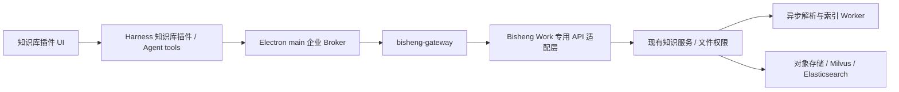

# BISHENG Work 知识库与企业商业授权设计草案

日期：2026-10-09。状态：设计提案，未实现、未部署、未执行集成验收。

版本基准修正：本文初稿读取的是 Gateway 当前 main。用户随后指定以 `v1.6.0@8f9390b0` 为基准；该标签保留基础 10 席位、管理员批量分配及到期超额席位收缩，当前 main 已移除这些机制。细化设计以 [Gateway 1.6.0 HTML 评审文档](design/bisheng-work-gateway-1.6.0.html) 为准，其中保留基础席位并独立授权知识 feature；新增 init/content/commit 上传合同避免沿用通用正文缓存路由。本文其余机制说明仍需按所列源码版本理解，不能把 main 行为套到 1.6.0。

## 1. 决策与适用范围

推荐采用内置 Harness 插件承载知识库 UI 和 Agent tools，Electron main 承载凭据及文件传输，bisheng-gateway 承载企业商业授权，Bisheng 承载知识业务和资源权限。

首期按企业已有 Bisheng 私有部署、企业采购 Work 席位和知识能力设计。SaaS 可复用合同，但需要增加订单、支付事件、订阅生命周期；这些不作为首期接入前置条件。不重新实现 Agent runtime、向量库或整套 Bisheng 前端。

## 2. 当前源码依据与缺口

- Work：`src/main/enterprise/enterprise-desktop.ts`、`credential-broker.ts`、`secure-credential-vault.ts` 已提供主进程凭据、loopback capability Broker 和登录/聊天/市场操作。
- Work：`packages/dsh-desktop-enterprise/` 已提供企业身份和模型适配插件；知识库应独立成能力插件，复用身份服务。
- Work：`packages/dsh-desktop-market-installer/enterprise-policy.mjs` 当前只发行企业版，关闭社区插件安装；不能假设本仓库已有免费/商业双版本产品矩阵。
- 当前安装的 Harness 具有 `ctx.tools.register(defineTool(...))`，聊天客户端具有公开 slots；具体知识入口使用哪个 slot，在实施时核对目标版本 owner props、布局和生命周期。本文不声明尚未核实的侧栏或输入框 slot。
- Gateway：`dsh/service/DshTokenService.java` 已提供 PKCE 兑换及 refresh 轮换；`DshIntrospectionService.java` 已校验 License、seat、session、grant_version。
- Gateway：`DshJwtService.java` 当前严格校验 HS256、10 个 claims、`aud=bisheng-dsh-model`，有效期不超过 600 秒。扩展 audience/scope 需要版本化，不能只改客户端。
- Gateway：`DshEntitlement.java` 当前是 License 有效期与席位容量，没有知识 feature/quota 合同。
- Gateway：`DshRoutes.java` 当前没有知识接口。
- Bisheng：`knowledge/api/endpoints/knowledge.py` 和 `knowledge_space.py` 已有上传、注册文件、处理和状态能力。上传返回 `file_path` 不等于已入库，更不等于可检索。
- Bisheng：`knowledge/domain/services/knowledge_space_chat_service.py` 的 `_retrieve_and_filter` 已有文件权限预过滤、结果后过滤及主版本过滤，应提取复用的检索服务。
- Bisheng：`user/domain/services/auth.py` 使用自己的 JWT issuer/key、tenant 和 token_version；不能直接接受现有 Gateway DSH token。
- 在本次查看的 Bisheng checkout 中，未找到 Gateway 所声明的 `/api/v1/dsh/*` 与内部身份接口实现。可能属于另一个版本/企业扩展，实施前需确认真实部署归属。

以上为本地源码观察，不证明线上版本或安装包已经具有这些能力。

## 3. 进程与服务边界

插件建议命名 `bisheng-work-knowledge`，包含 backend 与 `dsh.client` 入口。第一版随安装包内置，按企业 capability 显示及启用；后续可沿用受控企业市场升级。插件安装成功、功能授权有效、知识资源可访问分别判断。

Electron main：保存并刷新 access/refresh token；提供固定操作白名单；处理流式上传、原生文件选择、取消和账户 epoch。插件不取得 refresh token，不获得带凭据的任意 URL fetch。

Harness：注册 tools、本地受认证 API、会话知识空间选择和业务状态。renderer 仅取得公开状态、任务进度和结果。Broker capability 是进程级凭据，不是插件隔离沙箱；同进程插件及可执行工具属于企业信任边界，不能宣称能抵御本机管理员。

Gateway：判断是谁、企业是否授权 Work 知识能力、席位/会话是否有效、是否达到商业限额。Bisheng：判断该用户是否能列举空间、上传文件、检索片段、阅读来源。

## 4. 用户与 Agent 行为

- UI：选择可访问空间、选择目标目录、上传、查看处理进度、失败原因与重试、选择当前会话检索范围。
- Agent：注册 `knowledge_list_spaces`、`knowledge_search`、`knowledge_get_document`；上传工具必须受用户明确上传意图与文件授权约束，避免自动发布本地敏感文件。
- `knowledge_search` 返回片段而非第二次模型生成的答案。Work 继续用现有 Agent 与模型接口回答，避免双 Agent、重复会话和双重模型收费。
- 返回 space/document/version/chunk ID、页码、文本、来源标题和可授权打开的 citation ID。score 仅定义为当前检索管道相关性，不作为概率。
- 会话保存选择范围；切换企业/用户立即取消旧请求，旧任务按原账户归属保留，旧响应不得写入新账户。
- 知识文件可能包含指令，作为检索数据处理，不得提升为 system 指令或上传授权。
- Safe Mode 默认不启用知识业务插件，保留诊断和恢复入口；需要支持时另做安装包闭包及客户端发现验证。

## 5. API 合同提案

以下为待新增外部合同，不是现有可调用接口；统一归属 `/api/v1/dsh/knowledge`，由 Gateway 暴露、Bisheng 实现。

| 方法与相对路径 | 功能 |
| --- | --- |
| GET /capabilities | 合同版本、features、limits、授权状态 |
| GET /spaces?permission=read 或 upload | 服务端过滤后的空间列表 |
| POST /spaces/{space_id}/uploads | multipart 流式上传，生成 upload_id |
| POST /uploads/{upload_id}/commit | 校验上传归属、目标与摘要，注册文件并创建处理任务 |
| GET /jobs/{job_id} | 查询解析/索引状态；按需退避轮询 |
| POST /search | query、space_ids、目录/标签筛选、top_k |
| GET /documents/{document_id} | 经权限校验的正文/元数据 |
| GET /citations/{citation_id} | 经权限校验的来源定位与预览 |

不得把现有空间文件名搜索当作语义检索 API。从现有权限感知的 RAG 管道提取检索服务，保留可见性和主版本限制。

上传状态：receiving -> uploaded -> queued -> parsing -> indexing -> ready，另有 failed/cancelled。API 返回 202 表示接受任务；只有 ready 表示该版本可参与检索。适配层映射 Bisheng 现有状态，不要求强改其所有内部枚举。

首期采用经过 Broker/Gateway 的受限流式 multipart；不使用 JSON/base64，也不把任意机器路径传给 renderer。原生选取或已授权工作区文件转换为短期 file grant，绑定账户、文件与有效期。服务器向客户端提供 opaque upload_id，避免暴露现有存储 file_path。

`commit` 使用 Idempotency-Key，绑定 tenant/user/space/请求摘要；不确定网络错误时查询原任务，不盲目重传或重复扣额度。未提交暂存文件按 TTL 回收。大文件直传和断点续传留作后续，届时上传授权只绑定对象和尺寸，commit 仍需重新鉴权。

现有 Broker 的 JSON 请求、2 MiB JSON 响应和服务签名 canonical 的 64 KiB body 上限不能用于文件正文。文件链路单独定义流式大小、超时、限流、背压和取消；服务身份验证绑定元数据与内容摘要，不能把整个文件缓存进既有 HMAC helper。

## 6. 端到端 API 鉴权

### 6.1 桌面身份

复用系统浏览器企业 SSO -> 一次性授权票据 + PKCE -> Gateway 兑换 -> 主进程安全存储的流程，不在桌面打包 client_secret 或企业管理员 API key。

建议新增版本化 access token：`aud=bisheng-work-api`，绑定 `sub`、tenant、seat、session、grant_version；声明 scope 如 knowledge:read、knowledge:upload、model:invoke。scope 是可调用的 API 上限，不能代替具体空间/文件 ACL。

旧模型 token 仅用于旧模型路由；迁移期间两个 verifier 分别验证各自合同，旧 token 不得因升级自动获得知识权限。已有 refresh 会话能否升级需重新校验 feature 与用户状态。后端服务断连时商业鉴权失败关闭，不回退为管理员。

### 6.2 Gateway -> Bisheng 身份桥

推荐保持桌面 token 只由 Gateway 验证。Gateway 在校验后生成短期、面向 Bisheng 的用户委托凭证，使用独立非对称签名与可轮换 kid；包含可信 subject、当前租户、session、允许操作及 request_id。Bisheng 适配层校验签名、issuer、audience、有效期与服务来源，再加载真实用户状态、租户成员关系和 token_version/撤销状态。

现有方向性 HMAC/nonce 机制可复用到小型控制请求。首期也可据此实现内部身份查询；不能把客户端提交的 X-User-Id/X-Tenant-Id 当可信身份。Gateway 删除外部伪造的身份头；内部端口仅在受控服务网络开放。

Bisheng 使用专用 dependency 生成符合现有服务需要的 UserPayload/tenant context，不放宽全站 JWT verifier，不持有管理员通用凭据代替用户。明确授权组织与叶子租户映射，不能按用户请求体任意切换租户。

### 6.3 每次操作的检查

有效身份 + 有效 Work 席位/会话 + 企业知识 feature + API scope + 真实资源 ACL + 配额，全部满足才允许。

检索：空间/目录权限 -> 索引预过滤 -> 混合召回/精排 -> 文件结果后过滤 -> 返回片段；不可见内容不得进入 LLM、响应、日志或可共享缓存。引用打开重新鉴权，过期 URL 不成为永久授权。新增 API 的列表、上传 commit、job 查询、下载同样校验归属。

Introspection 当前能检查 License/seat/session，但其 Result 不返回完整用户身份，且不能单独视为已验证实时用户禁用/组织变更；需要扩展可信主体合同并执行 Bisheng 身份检查。缓存身份允许短 TTL，撤销传播目标必须明确；资源权限依旧由 Bisheng 实时判定。

## 7. 企业付费与配额

| 维度 | 建议 | 权威来源 |
| --- | --- | --- |
| 基础 Work | 企业授权 + 按成员分配的命名席位 | Gateway License/seat |
| 知识能力 | 可独立开关或套餐包含的 feature | 签名 License/订阅 |
| 数据范围 | 空间/目录/文件访问与上传权限 | Bisheng 现有权限体系 |
| 存储 | 企业共享容量；按在用对象与明确的版本保留规则计量 | Bisheng 对象/文件账本 |
| 解析 | 按成功页数或约定解析单位计量 | Worker 完成事件 |
| 检索 | 企业共享调用包 + 请求速率/并发限制 | 检索任务/用量账本 |
| LLM | 独立模型额度或套餐额度 | 现有模型用量链路 |

第一版推荐合同售卖“Work 席位 + 知识功能 + 共享容量/解析额度”，不按插件下载次数计费。普通成员只看可用状态和自己的用量；管理员管理采购、席位、额度和企业审计。

Gateway 扩展 entitlement 为版本化 features/limits，并返回 `/capabilities`。客户端仅用于展示，最终判断每个服务端请求。签名 License 为私有化授权依据，采购/订阅记录为商业事实；capabilities 为当前有效投影，不维护第四套独立真相。

已有 Bisheng QuotaService 应复用。企业购买限额由商业合同同步到唯一的 quota 服务；不要 Gateway/Bisheng 各扣一遍。需要为 Work 来源定义额度池，明确与 Bisheng Web 是否共享，不能默认把既有客户额度悄悄消费到新产品。

额度以原子预占 -> 成功结算/失败释放完成，避免并发超卖。成功作业通过事务 outbox 上报不可变用量事件，Gateway 商业报表按唯一事件 ID 去重；检索重试、文件重复 commit 不重复计量。速率限制不等于计费账本。

解析失败不收成功解析费用；上游实际已耗成本另入成本账。取消及重试的费用规则应写入产品合同。删除释放在用存储，不退历史解析费用。版本、备份和向量索引是否计入容量必须有明确口径。

License 到期或撤销：拒绝新上传/检索/模型调用，停止新增费用；保留文件、任务和审计，不删除客户数据。导出/续费/恢复由独立权限和服务端策略控制，不意外放开检索。已启动任务默认完成已有承诺并只结算一次，紧急安全撤销按明确规则取消。

私有化可使用签名 License 离线运行服务，不意味着桌面可离线检索服务器知识库；桌面离线知识同步属于另一项产品与安全设计。

## 8. 错误、审计和维护

区分 invalid_access_token/session_revoked、license_expired/feature_not_enabled/seat_revoked、resource_forbidden、quota_exceeded、rate_limited、document_not_ready、job_failed。UI 对应重新登录、联系管理员、申请权限、等待处理或重试；403 不执行无意义 token 刷新。

审计包含 request/job ID、主体、租户、动作、对象和结果，不记录 token、完整文档正文或默认完整检索 query。企业切换清理临时结果；缓存按主体、租户、权限修订和版本隔离。

## 9. 实施顺序与验收

1. 对齐三个仓库及真实部署版本，确认 DSH 企业后端扩展位置；冻结外部合同和 token v2 迁移。
2. Gateway 增加 knowledge feature、路由、委托身份和商业限制；Bisheng 增加身份适配并复用权限感知检索服务。
3. 先打通只读闭环：空间列表 -> 检索 -> Agent 引用 -> 授权预览。
4. 增加文件授权、流式上传、commit、job 状态、幂等与额度预占/结算。
5. 增加管理员额度/用量及可选企业市场升级，再进行安装包和真实企业验收。

核心回归：跨租户伪造、仅空间可见而文件不可见、不可上传空间、旧模型 token 被知识路由拒绝、refresh 重用、席位撤销、用户禁用、权限变更、License 过期、并发额度竞争、重复 commit、Worker 重复事件、退出/切租户途中上传、解析失败恢复、不可见 citation、空检索结果。

客户端验证包括真实 Harness 子进程、普通 Profile 的安装包插件闭包、客户端发现/引导/实际挂载、插件重载不重复注册，以及目标 Windows/macOS 原生文件和安装流程。单元测试、HTTP 200、插件已安装、正式发布分别报告，不互相代替。

## 10. 需要产品确认的两项选择

- 首期企业已有 Bisheng 私有部署还是托管 SaaS；本草案默认前者。
- Work 与 Bisheng Web 是否共享知识额度；本草案建议合同显式声明额度池，避免无意重复授权或扣费。
